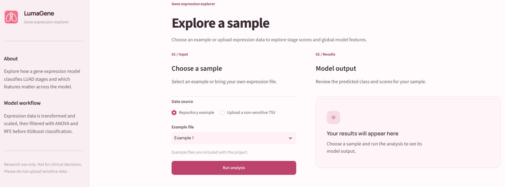
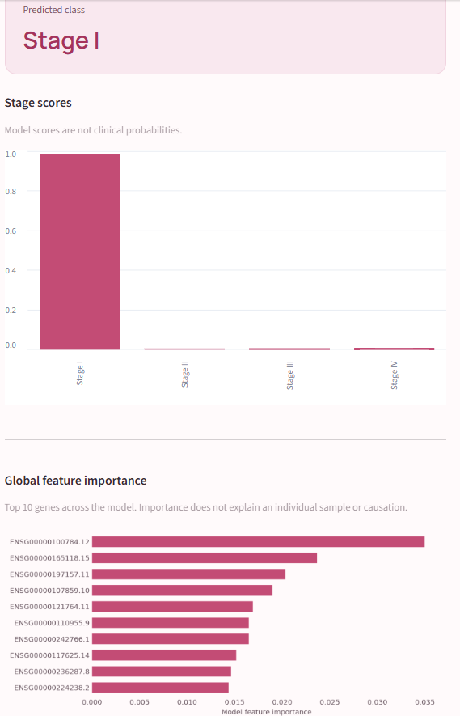
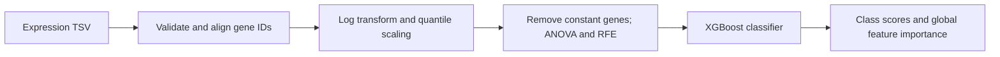
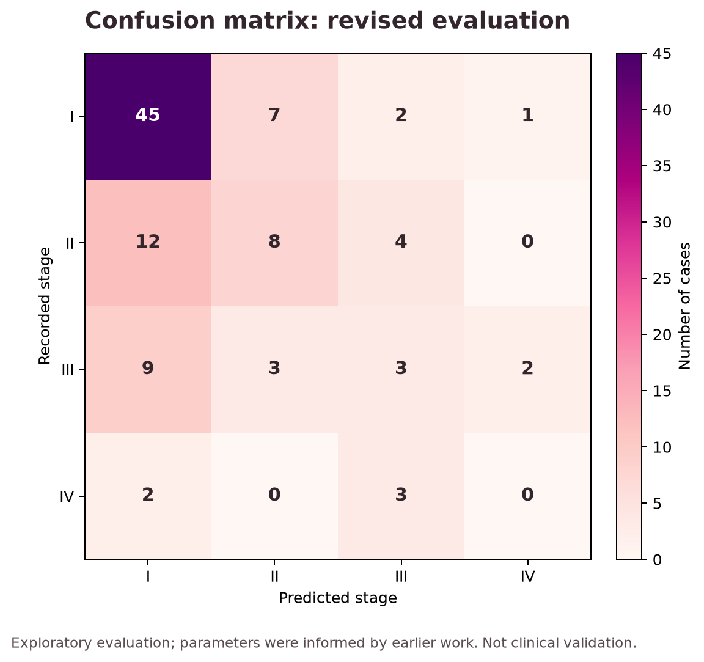
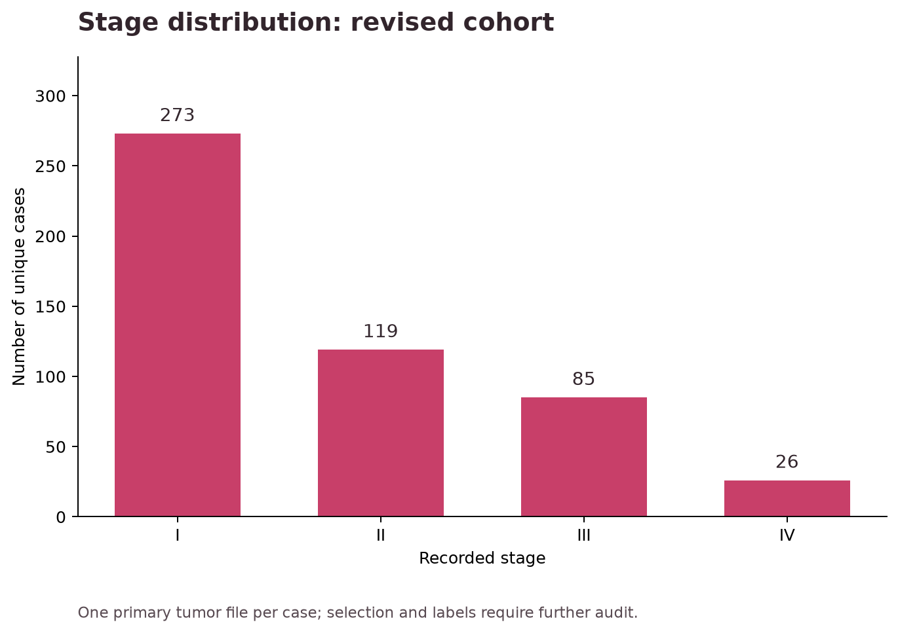
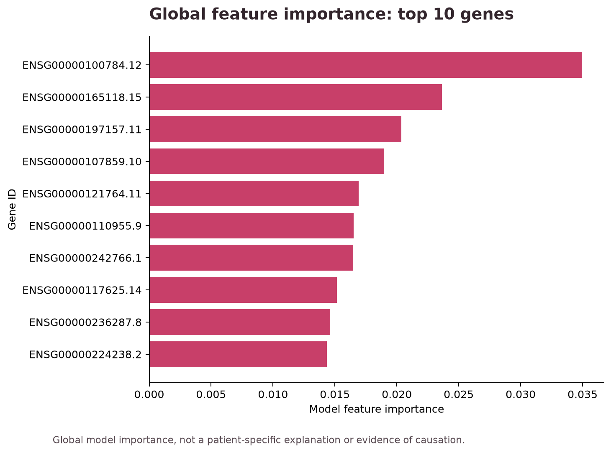

<div align="center">


# LumaGene

### Exploring LUAD stage classification from gene expression

An academic team prototype for examining a machine learning workflow and its limitations on TCGA-LUAD RNA-sequencing data.

[Evaluation notebook](./notebooks/revised_evaluation.ipynb) · [Historical notebook](./notebooks/historical_experiment.ipynb) · [TCGA-LUAD data](https://portal.gdc.cancer.gov/projects/TCGA-LUAD) · [Source repository](https://github.com/jadabyanza24/BioVis-Cancer)

</div>

> **Research prototype only.** This application is not a diagnostic device or a treatment guide. It has not been clinically validated or evaluated on an independent external cohort. Do not upload patient or sensitive data.

## Overview

LumaGene, developed as the BioVis-Cancer team project, combines a Streamlit interface with an exploratory model that classifies recorded lung adenocarcinoma (LUAD) stages from gene-expression profiles. The project connects GDC data acquisition, feature selection, model evaluation, inference, and visualization in a reproducible research workflow.

The model's performance is limited, particularly for the smallest stage class. Its outputs must not be used for medical decisions.

## Application preview



The initial view places sample selection alongside an empty results panel.



The output view uses a repository example. Its scores are model outputs, not clinical probabilities or evidence of accuracy. These screenshots show the local application and do not imply that a public deployment is available.

## Key features

- Explore a repository example or upload a non-sensitive TSV containing `gene_id` and `fpkm_unstranded` columns in a two-column workspace.
- Validate numeric values and align gene identifiers to the model's expected features. Missing required genes and duplicate IDs are rejected.
- View a predicted class and four model scores in the results panel. Results remain visible across reruns and clear when the selected source changes.
- Inspect the model's top 10 global feature importances. They are not patient-specific explanations, evidence of causation, or clinically validated biomarkers.
- Run the application with the bundled research model, or generate a new model and evaluation locally.

## How it works



During training only, SMOTE is applied after feature selection to the training data. It is not applied to inference inputs. The application verifies that the model file matches its evaluation report before loading it. This checksum detects mismatches; it does not make an untrusted serialized file safe to load.

## Methodology

### Data and preprocessing

The recorded experiment queried open-access TCGA-LUAD gene-expression files from the NCI Genomic Data Commons (GDC), using the `STAR - Counts` workflow and `fpkm_unstranded` values. The acquisition script selects one primary-tumor file per case when the associated sample and recorded pathologic stage are unambiguous. It records file IDs, sizes, and MD5 checksums in a local manifest.

The evaluated cohort contained **503 unique cases** and **60,660 gene columns**. Stages I through IV were mapped to four classes. The case-level dataset was split into 402 training and 101 held-out cases with stratification. The source data, sample selection, and stage labels remain subject to further audit.

For each training fold, the pipeline applies `log1p`, quantile scaling, removal of constant features, ANOVA selection of 500 features, and recursive feature elimination (RFE) to 150 features. SMOTE then resamples the training fold before XGBoost fitting. The log calculation uses float64 after matching the cohort's float32 storage, addressing numerical instability observed with constant genes during development.

### Evaluation design

Three-fold stratified cross-validation was run on the training cases, followed by a single evaluation on the held-out cases. A most-frequent-class classifier provides a baseline. Transformations, feature selection, and resampling are fitted within each training fold rather than on the full cohort.

The model hyperparameters were informed by an earlier experiment that had data leakage. Consequently, the held-out result is exploratory and should not be treated as an independent confirmation. The [historical notebook](./notebooks/historical_experiment.ipynb) preserves the original code and outputs with a warning; its metrics are not reliable performance estimates.

## Results

The following results come from the saved local evaluation, run on 28 October 2026. They describe one split of the selected cohort, not clinical performance or expected performance on new institutions.

| Held-out metric | XGBoost pipeline | Most-frequent baseline |
| --- | ---: | ---: |
| Accuracy | 0.554 | 0.545 |
| Macro F1 | 0.330 | 0.176 |
| Weighted F1 | 0.524 | 0.384 |

The model correctly classified 56 of 101 held-out cases. Its accuracy was close to the majority-class baseline, which correctly classified 55 of 101. Macro F1 reflects weaker performance across the less frequent classes. In particular, the model identified **0 of 5 stage IV cases** in this split. The small stage IV test set makes its estimated recall highly uncertain.



<details>
<summary>Additional evaluation visuals</summary>





</details>

## Technology

| Area | Tools |
| --- | --- |
| Interface | Streamlit, Matplotlib, custom CSS |
| Data acquisition and preparation | GDC API, requests, pandas, NumPy |
| Modeling | scikit-learn, imbalanced-learn, XGBoost |
| Artifacts and notebooks | joblib, Jupyter notebook format, nbclient |

## Repository structure

```text
BioVis-Cancer/
├── app.py                         # Streamlit interface
├── preprocessing.py               # Input validation and feature alignment
├── download_gdc.py                # GDC cohort selection and download
├── evaluate.py                    # Training and evaluation pipeline
├── plot_results.py                # Reproducible figure generation
├── requirements.txt               # Pinned Python dependencies
├── artifacts/                     # Bundled model and evaluation summary
├── assets/                        # Application logo
├── DataDummy/                     # Existing example expression files
├── figures/                       # Application preview and research figures
└── notebooks/                     # Revised and historical experiments
```

The interface uses the bundled revised pipeline or a matching pipeline generated locally.

## Run locally

The recorded environment used **Python 3.13.1**. From the project directory:

```bash
python -m venv .venv
```

Activate the environment:

```powershell
# Windows PowerShell
.\.venv\Scripts\Activate.ps1
```

```bash
# macOS or Linux
source .venv/bin/activate
```

Then install dependencies and start Streamlit:

```bash
python -m pip install -r requirements.txt
streamlit run app.py
```

The application first looks for a locally generated model and matching report in `outputs/`. If they are absent, it uses the bundled pair in `artifacts/`. Only load joblib or pickle artifacts from a trusted source, because deserialization can execute code.

### Reproduce the experiment

```bash
python download_gdc.py
python evaluate.py
```

The download uses network access and stores the selected files and manifest under `data/gdc/`. The evaluation writes a model and report to `outputs/`. These directories are ignored by Git. GDC data and API responses can change, so a newly downloaded cohort is not guaranteed to match the recorded run. The local manifest and report identify the files used in a particular run.

To generate the revised figures after evaluation:

```bash
python -c "from plot_results import revised_figures; revised_figures()"
```

The [revised notebook](./notebooks/revised_evaluation.ipynb) contains the workflow, saved output, and cells for creating the figures. The historical notebook is an archive; executing its original cells can overwrite model files or export patient-derived expression data.

## Validation

The bundled model was checked against the recorded held-out confusion matrix using the local evaluation data. The application was also exercised with a repository example. These checks do not establish clinical safety or external validity. No automated test suite is included in this version.

## Limitations

- This is an academic prototype, not a clinical decision-support system. Model scores are not established as calibrated clinical probabilities.
- The recorded test set is small for later stages, especially stage IV. The model missed all five stage IV cases in this evaluation.
- Hyperparameters were informed by a prior leaky experiment, and the revised model has not been tested on an independent external cohort.
- Feature importances describe global model behavior. They do not establish biological causality, patient-specific reasoning, or validated biomarkers.
- The existing example files appear to be derived from research expression data, not purely synthetic samples. Their exact provenance and possible overlap with model development have not been verified; filenames are not evaluation results.
- Uploaded inputs must contain every expected gene ID with an exact version match. Missing genes are not silently filled with zero.
- The bundled model was generated in the recorded Python and dependency environment. Compatibility with other versions is not guaranteed.

## Future work

- Audit cohort inclusion, stage labels, sample provenance, and potential overlap with the example files.
- Compare preprocessing and imbalance strategies using training-only cross-validation, then evaluate a separately reserved external cohort where available.
- Investigate class-specific errors, uncertainty, and calibration without treating model scores as clinical probabilities.
- Test robustness to changes in gene annotation versions and input preprocessing.
- Review privacy, security, and data-use requirements before any public hosting or use with sensitive data.

## Data, attribution, and license

This team project uses open-access TCGA-LUAD data made available through the [NCI Genomic Data Commons](https://gdc.cancer.gov/). See GDC documentation and the applicable data-use policies before reuse. The revised model and evaluation are derived from the local experiment described above; they are not evidence of clinical validation.

No license file is currently included in this repository. Confirm reuse terms with the repository owner before distributing project code or artifacts.
